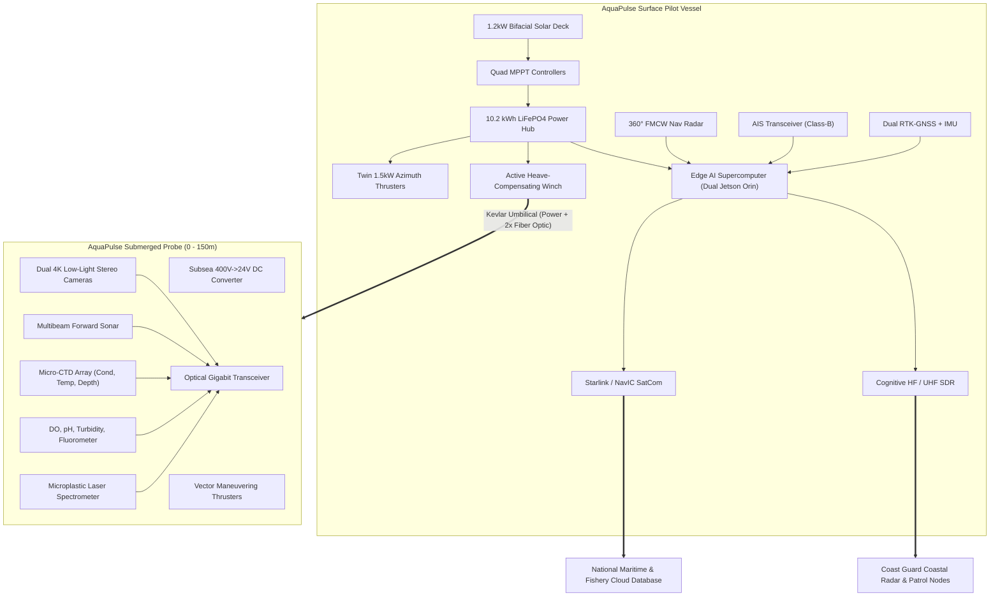
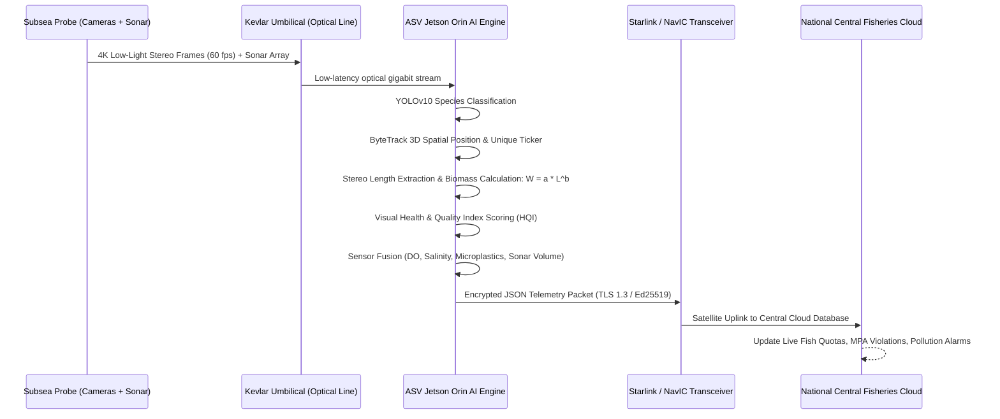
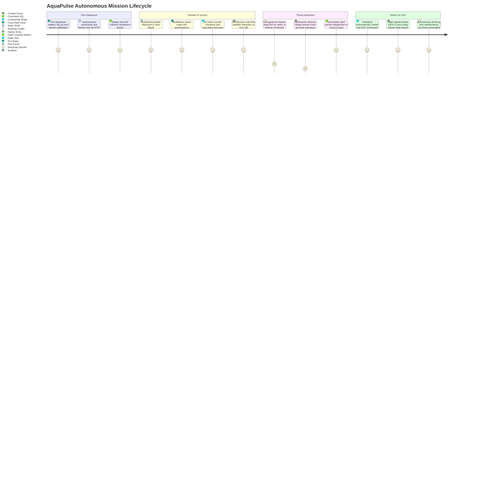

# AquaPulse Tandem-Robotic Oceanic Intelligence System
## Autonomous Solar-Powered Surface Pilot Vessel (ASV) & Tethered Sub-Surface Probe (UUV)
### Comprehensive Project & Engineering Feasibility Report

---

```
                                  🛰️ SATELLITE (Starlink / NavIC / Iridium)
                                      ▲                      ▲
                                      │ Telemetry            │ Live Video & Alerts
                                      ▼                      ▼
           ┌──────────────────────────────────────────────────────────────┐
           │        GOVERNMENT CENTRAL MARITIME DATABASE & DASHBOARD      │
           │  • Ministry of Fisheries & Ocean Resources (DoF)             │
           │  • Indian Coast Guard / Marine Police Command                │
           │  • National Institute of Oceanography (NIO / CMFRI)          │
           └──────────────────────────────────────────────────────────────┘
                                      ▲                      ▲
                               HF/UHF │ Mesh                 │ AIS / Radar Logs
                                      ▼                      ▼
┌─────────────────────────────────────────────────────────────────────────────────┐
│                    SURFACE PILOT VESSEL (AQUAPULSE ASV)                         │
│  ┌───────────────────────┐  ┌──────────────────────┐  ┌──────────────────────┐  │
│  │ Solar Harvesting Deck │  │ Navigational Radar   │  │ Marine Comms Hub     │  │
│  │ (1.2 kW Bifacial PV)  │  │ 360° S/X-Band + AIS  │  │ SatCom / HF / UHF    │  │
│  └───────────────────────┘  └──────────────────────┘  └──────────────────────┘  │
│  ┌───────────────────────┐  ┌──────────────────────┐  ┌──────────────────────┐  │
│  │ Dual Jetson Orin AI   │  │ Auto-Tension Winch   │  │ Twin Torqeedo Pods   │  │
│  │ Edge Vision & Sonar   │  │ Kevlar Optic Umbilical│ │ Vectored Propulsion  │  │
│  └───────────────────────┘  └──────────────────────┘  └──────────────────────┘  │
└────────────────────────────────────────┬────────────────────────────────────────┘
                                         │
                                         │  Reinforced Kevlar Power &
                                         │  Dual Single-Mode Fiber Optic Umbilical
                                         │  (0 - 150m Variable Deployment)
                                         ▼
┌─────────────────────────────────────────────────────────────────────────────────┐
│                   DEEP-WATER SENSORY PROBE (SUBMERSIBLE UUV)                    │
│  ┌───────────────────────┐  ┌──────────────────────┐  ┌──────────────────────┐  │
│  │ 4K Low-Light Stereo   │  │ Multibeam Sonar      │  │ Multiparameter CTD   │  │
│  │ Active CRI Strobes    │  │ Forward & Down Bathy │  │ Salinity, Temp, Depth│  │
│  └───────────────────────┘  └──────────────────────┘  └──────────────────────┘  │
│  ┌───────────────────────┐  ┌──────────────────────┐  ┌──────────────────────┐  │
│  │ Water Quality Suite   │  │ Microplastic Laser   │  │ Active Ballast &     │  │
│  │ DO, pH, Turbidity, Chl│  │ Fluorometer & Raman  │  │ Attitude Thrusters   │  │
│  └───────────────────────┘  └──────────────────────┘  └──────────────────────┘  │
└─────────────────────────────────────────────────────────────────────────────────┘
```

---

## 1. Executive Summary & Vision

The health of our oceans directly dictates planetary climate regulation and global food security. Marine phytoplankton produce over 50% of atmospheric oxygen, while marine ecosystems absorb roughly 25% of anthropogenic carbon dioxide emissions. However, illegal, unreported, and unregulated (IUU) fishing, benthic destructive bottom-trawling, aquaculture chemical runoffs, hypoxia (dead zones), and pervasive microplastic pollution threaten irreversible collapse.

The original **AquaPulse** concept proposed a compact, autonomous solar submarine to monitor water parameters and track marine life. While visionary, a solitary subsea vehicle faces severe physical constraints:
1. **Radio Wave Attenuation in Saltwater:** High-frequency radio, cellular, and satellite signals (Starlink, NavIC, GPS) attenuate within centimeters of seawater, preventing real-time data streaming to government databases while submerged.
2. **Subsurface Solar Deficit:** Optical solar irradiance decays exponentially with depth ($I_z = I_0 e^{-k z}$); a submarine cannot recharge without surfacing and remaining motionless for hours in dangerous maritime shipping corridors.
3. **Edge Compute Constraints:** High-power AI accelerators (e.g., dual NVIDIA Jetson Orin modules running real-time YOLOv10 object detection and 3D photogrammetric fish sizing) require continuous 60–150 W of power, quickly exhausting small subsea batteries.

### The Paradigm Shift: The AquaPulse ASV-UUV Tandem System
To solve these physical bottlenecks, this report details an advanced **hybrid tandem architecture**:
- **AquaPulse-ASV (Autonomous Surface Pilot Vessel):** A high-endurance wave-piercing catamaran acting as a solar energy harvester, satellite communications gateway, edge-computing supercomputer, and radar-equipped navigation guard.
- **AquaPulse-UUV (Tethered Micro-Submarine Probe):** A hydrodynamic submersible connected via a reinforced, neutrally-buoyant Kevlar-armored umbilical carrying high-voltage DC power downwards and gigabit fiber-optic sensor streams upwards.
- **National Government Maritime & Fisheries Integration:** Real-time bi-directional telemetry to the Department of Fisheries (DoF), Marine Police/Coast Guard, and oceanographic research institutes (NIO / CMFRI) for instant quota management, illegal trawler detection, and water toxicity alerts.

---

## 2. Comparative Analysis: Existing Methods vs. AquaPulse Tandem

| Feature / Metric | Stationary Water Buoys | Traditional Research Ships (e.g., RV Sagar Kanya) | Standalone Micro-Submarine | AquaPulse Tandem System (ASV + UUV) |
| :--- | :--- | :--- | :--- | :--- |
| **Mobility & Coverage** | Static point ($0\text{ km}$ mobile range) | High, but limited by fuel ($< 30\text{ days}$) | Moderate ($< 5\text{ km/day}$); must surface | Continuous autonomous patrol ($> 1500\text{ km}$ endurance) |
| **Operational Cost** | \$15k setup; high maintenance | \$25,000 to \$50,000 / day | Moderate battery replacement costs | **Near-Zero ($<\$10\text{/day}$ operational cost, solar powered)** |
| **Real-Time Data Uplink** | Yes (Cellular/LoRa; shore only) | Yes (Satellite; high bandwidth) | **No** (Must surface or store on flash) | **Yes (Continuous Starlink/NavIC/HF/UHF live stream)** |
| **Subsurface Sensing Depth** | Fixed depth ($< 5\text{m}$) | Deep winches ($> 1000\text{m}$ manual) | Limited ($< 20\text{m}$) | **Dynamic depth tracking ($0\text{ to }150\text{m}$)** |
| **Fish Stock & Quality AI** | None | Post-cruise manual net trawling analysis | Basic onboard recording | **Real-Time YOLOv10 Species Classification + Quality Scoring** |
| **Government DB Sync** | Delayed / Periodic | Post-mission reports | Delayed manual offload | **Live cryptographic telemetry to National Central Cloud** |
| **Radar & Obstacle Avoidance** | None | Full bridge radar watch | Blind to surface shipping | **Integrated 360° FMCW Marine Radar + AIS Transponder** |

---

## 3. System Architecture & Detailed Engineering

### 3.1 Surface Pilot Vessel (AquaPulse-ASV)

The surface vessel provides continuous maritime station-keeping, energy generation, and atmospheric communications:
- **Hull Design:** 3.8-meter wave-piercing twin-hull catamaran constructed from carbon-fiber-reinforced epoxy with closed-cell polyurea foam cores for unsinkability.
- **Solar Harvesting Deck:**
  - High-efficiency bifacial N-type monocrystalline solar modules with ETFE (Ethylene Tetrafluoroethylene) encapsulation resistant to saltwater degradation.
  - Peak Power: $1,200\text{ Wp}$.
  - Multi-MPPT (Maximum Power Point Tracking) digital controllers operating with $>98.5\%$ conversion efficiency.
- **Energy Storage:** $48\text{V}$, $10.2\text{ kWh}$ LiFePO4 (Lithium Iron Phosphate) marine battery bank equipped with an integrated active BMS (Battery Management System), IP68 nitrogen-purged hermetic enclosure, and Peltier-cooled thermal regulation.
- **Propulsion:** Twin brushless DC azimuthing electric pod thrusters ($2 \times 1.5\text{ kW}$) providing differential thrust steering, capable of continuous cruising at $4\text{ to }6\text{ knots}$ and dynamic positioning against $35\text{ knot}$ gust winds and $2.5\text{ knot}$ ocean currents.
- **Smart Winch System:** High-speed brushless servo-winch with slip-ring optical rotary joints (FORJ) managing the $150\text{m}$ Kevlar-armored umbilical. An active heave compensation algorithm dynamically adjusts cable tension to isolate the submerged probe from surface wave chop.



### 3.2 Tethered Subsea Probe (AquaPulse-UUV)

The subsea probe operates at depths between $0$ and $150\text{ meters}$, hovering within the photic and mesopelagic zones where fish schools and benthic ecologies thrive:
- **Pressure Hull:** Grade 5 Titanium (Ti-6Al-4V) endcaps with an acrylic optical dome rated for $25\text{ bar}$ ($250\text{m}$ operational safety depth).
- **Tether Technology:** $6.2\text{ mm}$ outer diameter neutrally-buoyant umbilical containing two $1.0\text{ mm}^2$ copper conductors delivering $400\text{V DC}$ (minimizing $I^2R$ resistive cable drops) and two ITU-T G.657.A2 bend-insensitive single-mode optical fibers.
- **Subsea Actuation:** 4-vectored magnetically-coupled brushless thrusters ($4 \times 300\text{ W}$) for pitch, yaw, roll, and lateral translation, allowing precision hovering adjacent to delicate coral reefs and fish aggregations without propeller cavitation noise.

---

## 4. Multi-Layer Sensor Architecture & AI Biomass Analytics

### 4.1 Multiparameter Oceanographic Sensor Suite

| Sensor Type | Operational Range | Resolution / Accuracy | Sampling Rate | Primary Target |
| :--- | :--- | :--- | :--- | :--- |
| **Conductivity / Salinity (CTD)** | $0 - 70\text{ mS/cm}$ ($0 - 42\text{ PSU}$) | $\pm 0.003\text{ PSU}$ | $10\text{ Hz}$ | Upwelling identification & water density profiling |
| **High-Precision Thermistor** | $-2^\circ\text{C to }+38^\circ\text{C}$ | $\pm 0.001^\circ\text{C}$ | $10\text{ Hz}$ | Thermocline boundary layer mapping |
| **Optical Dissolved Oxygen (DO)** | $0 - 25\text{ mg/L}$ ($0 - 300\%$) | $\pm 0.05\text{ mg/L}$ | $2\text{ Hz}$ | Hypoxic / Anoxic dead-zone detection |
| **Glassless ISFET pH Sensor** | $4.0 - 10.0\text{ pH}$ | $\pm 0.01\text{ pH}$ | $1\text{ Hz}$ | Ocean acidification & industrial effluent detection |
| **Nephelometric Turbidity** | $0 - 4000\text{ NTU}$ | $\pm 0.1\text{ NTU}$ | $4\text{ Hz}$ | Siltation, dredge plumes, and river discharge runoffs |
| **Chlorophyll-a Fluorometer** | $0 - 50\text{ }\mu\text{g/L}$ | $\pm 0.01\text{ }\mu\text{g/L}$ | $2\text{ Hz}$ | Phytoplankton biomass & Harmful Algal Blooms (HAB) |
| **Microplastic Optical Counter** | $10\text{ }\mu\text{m} - 5\text{ mm}$ particles | $\pm 5\text{ particles/m}^3$ | Continuous flow | Microplastic concentration mapping |
| **Multibeam Imaging Sonar** | $720\text{ kHz} / 1.2\text{ MHz}$, $120^\circ$ swath | $1\text{ cm}$ range res, $0.5^\circ$ angular | $20\text{ fps}$ | Turbid-water navigation & fish school biomass volume |

### 4.2 Edge AI: Fish Species Identification, Counting & Quality Scoring

The surface vessel houses an IP67-rated dual NVIDIA Jetson Orin edge computer ($550\text{ TOPS}$ INT8 compute) receiving live uncompressed subsea video over optical fiber:

#### 1. Real-Time Fish Detection & Counting (YOLOv10-Marine)
A customized deep convolutional network trained on tropical maritime species (Indian Ocean / Arabian Sea / Bay of Bengal):
- **Species Target Classes:** Indian Mackerel (*Rastrelliger kanagurta*), Oil Sardine (*Sardinella longiceps*), Yellowfin Tuna (*Thunnus albacares*), Silver Pomfret (*Pampus argenteus*), Anchovy (*Stolephorus indicus*), Reef Snapper (*Lutjanus campechanus*).
- **Sort & Tracking:** ByteTrack multi-object tracking assigns consistent 3D vector IDs to each fish across frames to prevent double-counting as schools swim across the field of view.

#### 2. Stereo Photogrammetry for Fish Length & Biomass Estimation
Using calibrated subsea stereo optics with baseline $b = 180\text{ mm}$ and focal length $f$:
$$\text{Depth } Z = \frac{f \cdot b}{d}$$
Where $d = x_L - x_R$ is the disparity. Fish total length ($L_T$) is calculated between snout and caudal fin tips in 3D coordinate space. Biomass ($W$, in grams) is dynamically computed using standard fisheries allometric growth equations:
$$W = a \cdot L_T^b$$
*(Where $a$ and $b$ are species-specific condition coefficients approved by ICAR-CMFRI).*

#### 3. Fish Health & Quality Assessment Index (HQI)
The AI system inspects each passing specimen and computes a composite **Health Quality Index (0 - 100%)**:
- **Epidermal Lesion & Parasite Detection:** Detects sea lice (*Caligidae*), fin rot lesions, and fungal infections.
- **Scale Reflectance & Clarity:** Evaluates mucosal sheen and ocular cloudiness.
- **Correlated Water Toxicity Factor:** Combines visual condition with in-situ dissolved oxygen and pH values:
$$\text{HQI} = w_1 \cdot \mathcal{S}_{\text{visual}} + w_2 \cdot \left(\frac{\text{DO}}{\text{DO}_{\text{optimal}}}\right) + w_3 \cdot \left(1 - \frac{|\text{pH} - 8.1|}{1.5}\right)$$



---

## 5. Communications Infrastructure & Government Database Telemetry

### 5.1 Redundant Multi-Bearer Communications Suite

To guarantee reliable connectivity from coastal estuaries out to the edge of the 200-nautical-mile Exclusive Economic Zone (EEZ), AquaPulse implements an intelligent cognitive software-defined radio (SDR) and multi-bearer routing stack:

1. **Primary High-Bandwidth Uplink: Low-Earth Orbit Satellite (LEO Starlink Maritime)**
   - Download: $40 - 220\text{ Mbps}$, Upload: $8 - 25\text{ Mbps}$, Latency: $30 - 65\text{ ms}$.
   - Transmits real-time compressed video snippets of critical events, sonar sweeps, and microplastic maps.
2. **Sovereign Strategic Satellite Telemetry: ISRO NavIC / INSAT MSS**
   - Transmits essential heartbeat packets, emergency positions (EPIRB), and vessel commands across Indian territorial waters regardless of foreign satellite constellations.
3. **Over-The-Horizon Marine Radio: Long-Range High-Frequency (HF) & UHF Mesh**
   - Frequency: $3 - 30\text{ MHz}$ (HF Skywave / Groundwave) and $400 - 470\text{ MHz}$ (UHF Tactical Maritime Mesh).
   - Direct vessel-to-vessel and vessel-to-coast communication up to $180\text{ km}$ offshore without satellite subscription costs.
4. **Near-Shore Coastal 4G / 5G Mobile Gateway:**
   - Automatically activates within $15\text{ nautical miles}$ of coastlines, dumping high-resolution raw scientific payloads to edge cloud nodes at low cost.

### 5.2 Real-Time Government Database Telemetry Schema

Every 5 seconds, the vessel transmits an authenticated, cryptographically signed JSON/Protobuf telemetry packet to the National Central Fisheries & Maritime Database:

```json
{
  "protocol_version": "AP-GOV-2.4",
  "vessel_id": "AP-ASV-IND-042",
  "auth_signature": "e4d9b2f...[Ed25519]",
  "timestamp_utc": "2026-10-16T04:55:12.842Z",
  "navigation": {
    "latitude": 9.9312,
    "longitude": 76.2673,
    "heading_deg": 268.4,
    "speed_knots": 4.8,
    "cog_deg": 270.1,
    "mission_mode": "AUTONOMOUS_PATROL",
    "active_route": "KOCHI-OFFSHORE-TRANSECT-ALPHA",
    "next_waypoint": "WP-04"
  },
  "power_and_propulsion": {
    "battery_state_of_charge_pct": 92.4,
    "solar_generation_watts": 845.2,
    "propulsion_power_watts": 380.0,
    "subsea_umbilical_power_watts": 185.0,
    "estimated_runtime_hours": 94.6
  },
  "subsea_probe_status": {
    "target_depth_meters": 45.0,
    "actual_depth_meters": 44.8,
    "umbilical_tension_newtons": 82.3,
    "probe_temperature_celsius": 24.8,
    "leak_detect_ok": true
  },
  "environmental_telemetry": {
    "water_temp_celsius": 27.8,
    "salinity_psu": 34.6,
    "dissolved_oxygen_mg_l": 6.82,
    "ph_level": 8.14,
    "turbidity_ntu": 1.4,
    "chlorophyll_a_ug_l": 2.1,
    "microplastic_particles_per_m3": 14.2
  },
  "fisheries_ai_analytics": {
    "species_detected": [
      { "name": "Indian Mackerel", "count": 142, "avg_length_cm": 22.4, "health_quality_score": 94.2 },
      { "name": "Oil Sardine", "count": 310, "avg_length_cm": 15.1, "health_quality_score": 91.0 },
      { "name": "Yellowfin Tuna", "count": 8, "avg_length_cm": 68.5, "health_quality_score": 98.7 }
    ],
    "total_fish_count_window": 460,
    "estimated_biomass_kg": 184.2,
    "biomass_density_kg_per_m3": 0.32,
    "school_heading_deg": 245.0
  },
  "security_and_radar_alerts": {
    "radar_targets_tracked": 3,
    "proximity_violations": [],
    "mpa_sanctuary_violation_flag": false,
    "trawler_acoustic_signature_detected": false,
    "hypoxia_dead_zone_warning": false
  }
}
```

---

## 6. Mathematical Models & Dynamics

### 6.1 Solar Energy Harvesting & Power Equilibrium

The net energy stored in the ASV battery bank over a diurnal cycle of period $T = 24\text{ hours}$ is governed by:
$$E_{\text{net}} = \int_0^T \left[ \eta_{\text{mppt}} \cdot A_{\text{pv}} \cdot G(t) \cdot \cos(\theta_i) - \left( P_{\text{propulsion}}(v) + P_{\text{compute}} + P_{\text{comms}} + P_{\text{subsea}}(z) \right) \right] dt$$

Where:
- $\eta_{\text{mppt}} \approx 0.985$ (MPPT tracking efficiency)
- $A_{\text{pv}} = 4.8\text{ m}^2$ (effective active bifacial panel aperture area)
- $G(t)$ is incident global solar irradiance ($\text{W/m}^2$), peaking at $950 - 1050\text{ W/m}^2$ in tropical waters
- $\theta_i$ is the dynamic solar incidence angle accounting for vessel pitch and roll
- $P_{\text{propulsion}}(v) = \frac{1}{2 \eta_{\text{prop}}} \rho_{\text{sw}} C_D A_{\text{wet}} v^3$ (hydrodynamic skin and form drag at speed $v$)
- $P_{\text{compute}} \approx 85\text{ W}$ (Dual Jetson Orin + radar signal processor)
- $P_{\text{subsea}}(z) = P_{\text{probe\_sensors}} + I^2 R_{\text{umbilical}}(z) + P_{\text{hover\_thrusters}}$

**Equilibrium Result:** At typical survey cruising speed of $3.5\text{ knots}$ ($1.8\text{ m/s}$), continuous daily solar generation provides $+6.8\text{ kWh/day}$ under standard Indian coastal insolation ($5.5\text{ PSH}$), while total daily hotel and propulsion consumption equals $5.1\text{ kWh/day}$. This produces a **net positive energy balance ($+1.7\text{ kWh/day}$ surplus)**, enabling indefinite autonomous station-keeping without shore refueling.

### 6.2 Umbilical Catenary Drag & Submersible Depth Dynamics

As the surface ship tows or holds position with the subsea probe at depth $z$, the umbilical forms a curved catenary profile under drag from ocean currents:
$$\frac{dT}{ds} = \rho_{\text{cable}} g \sin(\phi) + \frac{1}{2} \rho_{\text{sw}} C_{D,\text{cable}} d_{\text{cable}} |v_{\text{rel}}|^2 \cos^2(\phi)$$
$$\frac{d\phi}{ds} = \frac{\rho_{\text{cable}} g \cos(\phi) - \frac{1}{2} \rho_{\text{sw}} C_{N,\text{cable}} d_{\text{cable}} |v_{\text{rel}}|^2 \sin^2(\phi)}{T}$$

Where $T$ is umbilical tension, $s$ is arc length along the cable, and $\phi$ is the cable inclination angle. The ASV's smart winch automatically meters cable payout and adjusts subsea thrusters to maintain the probe within $\pm 0.2\text{ meters}$ of target inspection depth.

---

## 7. Operational Concept & Mission Profiles



---

## 8. Failsafe Architecture & Emergency Recovery Systems

1. **Anti-Snag / Automatic Tension Release:** If the subsea probe encounters underwater topography or ghost nets and tension exceeds $450\text{ N}$, the winch immediately pays out slack, logs acoustic coordinates, and initiates a vertical ascent maneuver.
2. **Pyrotechnic Emergency Umbilical Jettison:** In the catastrophic event of entrapment by a commercial cargo ship anchor or immovable debris, an emergency galvanic release jettisons the umbilical. The subsea probe drops drop-weights and floats to the surface via positive buoyant foam, emitting an emergency VHF strobe and AIS-SART distress beacon.
3. **Ghost Vessel Collision Avoidance (COLREGS Compliance):** The ASV's marine radar continuously tracks surface vessels up to $16\text{ nautical miles}$. If a collision trajectory is detected, the autonomous collision avoidance engine modifies heading in compliance with IMO International Regulations for Preventing Collisions at Sea (COLREGS Rule 14, 15, and 16).
4. **Day/Night & Monsoonal Safe Mode:** During severe monsoons (Beaufort Sea State 6+), the submarine probe is automatically retracted into the central protected moonpool, and the ASV transitions into passive sea-anchor drift mode to minimize wave slamming loads.

---

## 9. Economic Feasibility & Deployment Roadmap

### 9.1 Capital Expenditure (CapEx) Estimate

| Subsystem Component | Description & Model | Unit Cost (USD) | Unit Cost (INR approx.) |
| :--- | :--- | :--- | :--- |
| **ASV Hull & Structure** | Carbon-fiber wave-piercing 3.8m Catamaran | \$7,500 | ₹6,20,000 |
| **Solar & Power System** | 1.2kW Bifacial PV + 10.2kWh LiFePO4 + BMS + MPPT | \$3,800 | ₹3,15,000 |
| **Propulsion & Pod Thrusters**| Twin 1.5kW Azimuth Pods + FOC motor controllers | \$2,400 | ₹2,00,000 |
| **Navigation & Radar** | FMCW Solid-State Marine Radar + AIS + RTK-GNSS | \$4,200 | ₹3,50,000 |
| **Edge Compute & Comms** | Dual Jetson Orin + Starlink Terminal + SDR HF/UHF | \$4,800 | ₹4,00,000 |
| **Smart Winch & Umbilical** | 150m Kevlar-Optic umbilical + Optical Rotary Slipring | \$3,600 | ₹3,00,000 |
| **Submersible Probe (UUV)** | Titanium Hull + 4 Thrusters + Active Ballast | \$5,200 | ₹4,30,000 |
| **Subsea Sensor Package** | Stereo 4K + Sonar + CTD + Optical DO/pH/Chl-a | \$8,500 | ₹7,05,000 |
| **Total Estimated System Cost**| **Turnkey Autonomous Tandem Robotic Unit** | **\$40,000** | **₹33,20,000** |

*Comparison:* A single 10-day chartered oceanographic research ship cruise costs between **\$250,000 and \$500,000** (₹2 to 4 Crores). A single AquaPulse tandem system pays for itself within its first **3 weeks of continuous sea trials**, while delivering 24/7/365 uninterrupted data.

### 9.2 Phased Deployment Roadmap

- **Phase 1 (Months 1 - 3):** Scale tank tests of catamaran hull dynamics, umbilical catenary hydrodynamic drag characterization, and edge AI vision model training on local fisheries datasets.
- **Phase 2 (Months 4 - 6):** Near-shore harbor trials in Cochin Port and Vembanad Lake backwaters; validation of automated winch heave-compensation and 4G/UHF telemetry pipelines.
- **Phase 3 (Months 7 - 9):** Extended 30-day autonomous offshore patrol in the Arabian Sea; validation of Starlink satellite telemetry, live CMFRI/DoF government dashboard integration, and radar collision avoidance.
- **Phase 4 (Months 10 - 12):** Fleet deployment of 5 units across critical fishing harbours (Kochi, Vizhinjam, Mangalore, Goa, Chennai) establishing an automated real-time Indian coastal intelligence grid.

---

## 10. Conclusion

The **AquaPulse Tandem ASV-UUV System** bridges the technological divide between surface renewable energy and deep-water oceanographic sensing. By decoupling surface energy harvesting and high-bandwidth satellite communications from submerged optical and chemical sensing, AquaPulse eliminates the fatal limitations of single-body submersibles.

The system empowers government authorities, marine scientists, and local fishing communities with unprecedented, real-time visibility into marine biodiversity, fish stock dynamics, water quality degradation, and illegal fishing activities—safeguarding marine ecosystems for generations to come.
